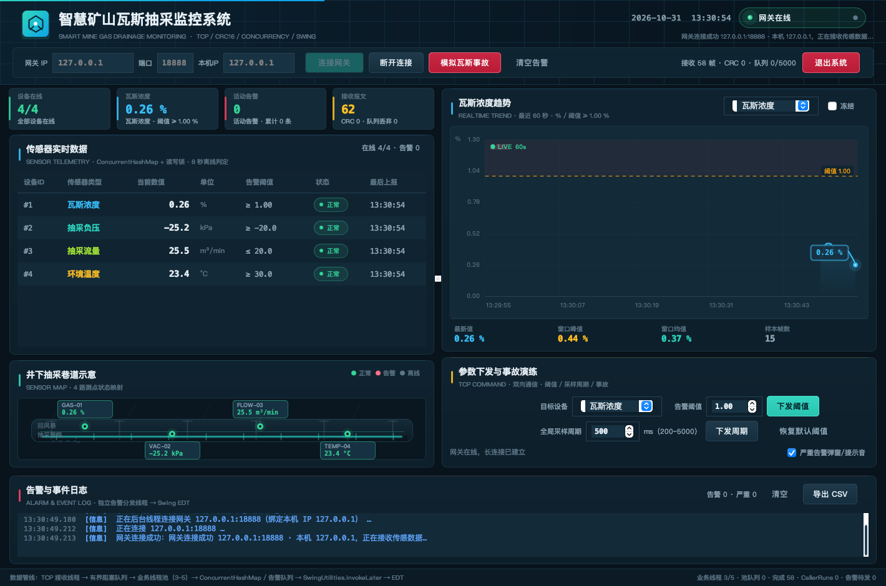
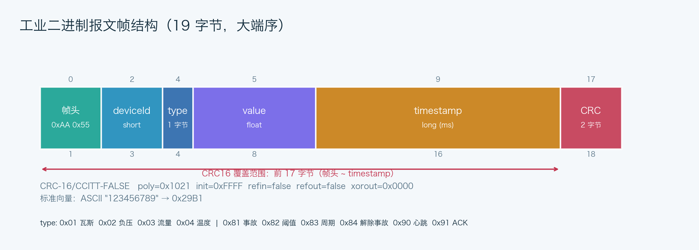
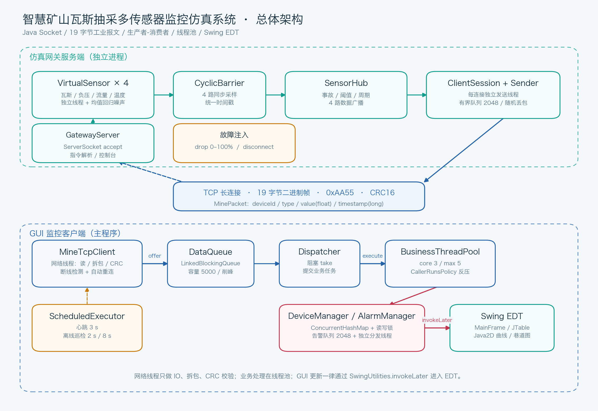
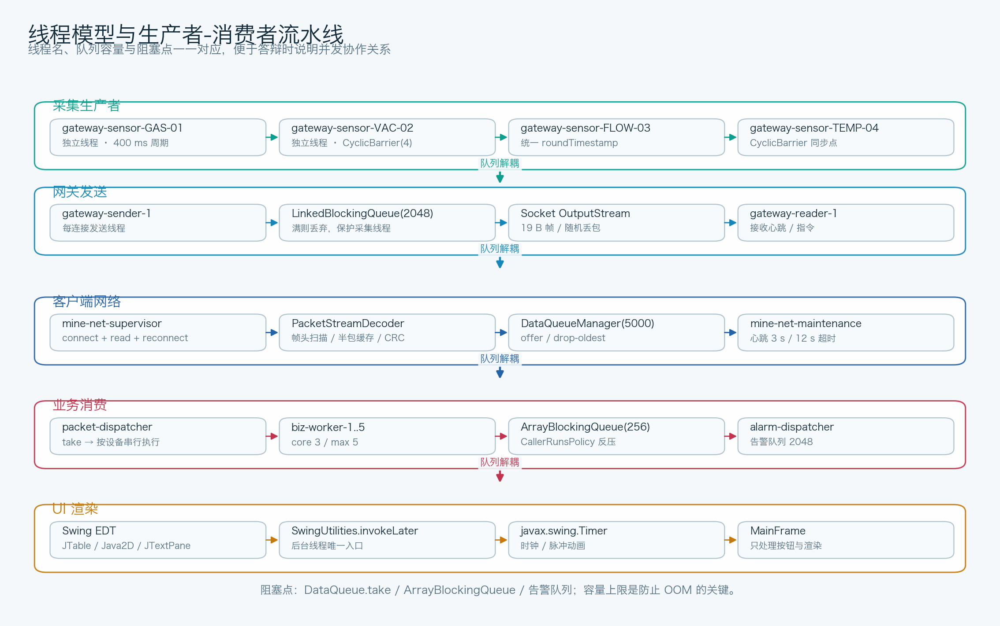
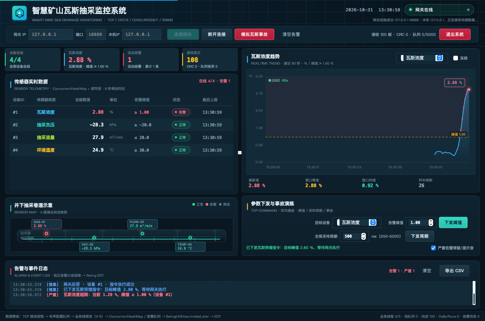
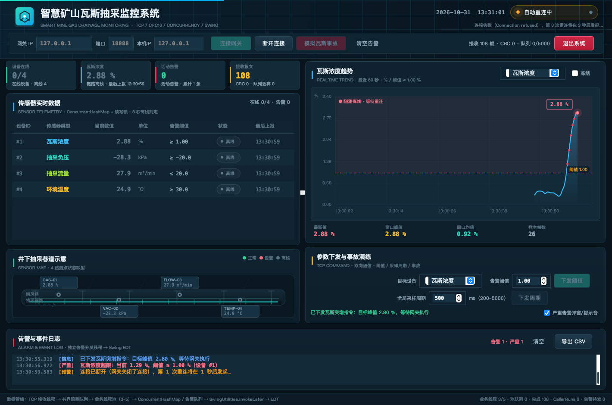

# 基于 TCP 与 Java 并发的智慧矿山瓦斯抽采多传感器监控仿真系统

> 课程设计项目 · Java Socket / 多线程与线程池 / 阻塞队列 / ConcurrentHashMap / 读写锁 / 自定义二进制报文 / CRC16 / Swing GUI

一个可完整演示的“井下边缘网关 + 上位机监控客户端”仿真系统：网关用 4 个独立线程模拟瓦斯、负压、流量、温度传感器，通过 TCP 长连接推送 19 字节二进制报文；客户端采用生产者-消费者模型完成拆包、CRC 校验、线程池业务处理、并发设备状态维护与告警，并严格通过 `SwingUtilities.invokeLater` 在 EDT 上刷新界面。



## 1. 快速开始

环境要求：**JDK 8 或 JDK 17+**，无需 Maven、无需第三方依赖。

```bash
# macOS / Linux
chmod +x build.sh run-gateway.sh run-client.sh run-tests.sh
./build.sh

# 终端 1：启动仿真网关（默认 127.0.0.1:8888）
./run-gateway.sh

# 终端 2：启动 GUI 客户端
./run-client.sh
```

客户端启动后，在顶部输入网关 IP `127.0.0.1`、端口 `8888`，点击【连接网关】即可。

连接前可以先跑网络预检（需要网关已经启动）：

```bash
./check-network.sh --host 127.0.0.1 --port 8888 --local-ip 127.0.0.1
```

看到 `[PASS] 网络预检通过` 再启动客户端。

> **连接地址范围**：客户端仅允许连接 `172.20.205.0 ~ 172.20.224.255` 网段内的网关；本机联调额外放行 `127.0.0.1` / `localhost`。网关绑定地址不受此限制（`127.0.0.1`、`0.0.0.0` 或本机实际 IP 均可）。
>
> **每台工控机**：客户端顶部新增【本机IP】字段，可绑定该工控机的源地址；留空则自动使用系统源地址。也可以使用 `--local-ip` 参数。详细步骤见 [工控机 IP 配置](docs/工控机IP配置.md)。

Windows：

```bat
build.bat
run-gateway.bat
check-network.bat --host 127.0.0.1 --port 8888 --local-ip 127.0.0.1
run-client.bat --host 127.0.0.1 --local-ip 127.0.0.1 --auto-connect
```

### 启动脚本怎么选

当前 macOS 演示只需要下面 6 个 `.sh`：

| 脚本 | 用途 | 是否必留 |
| --- | --- | --- |
| `build.sh` | 编译、生成两个 JAR | 必留 |
| `run-gateway.sh` | 启动仿真网关 | 必留 |
| `run-client.sh` | 启动 Swing 客户端 | 必留 |
| `run-client-pc.sh` | 带本机工控机 IP 启动客户端 | 推荐（多机演示） |
| `check-network.sh` | 连接前检查 IP/端口/心跳 ACK | 推荐 |
| `run-tests.sh` | 运行 92 项自动化自检 | 验收时用 |

`*.bat` 是 Windows 等价脚本，当前 Mac 不需要；如果课程可能拿到 Windows 电脑演示就保留，确定只在 macOS 运行可以忽略。`pom.xml`、`scripts/*.py` 不是启动脚本，分别是可选 Maven 配置和报告/绘图工具，不影响系统运行。

也可以直接用 IDE 运行：

- 网关入口：`com.mine.gateway.GatewayMain`
- 客户端入口：`com.mine.client.MainClient`
- `--host` / `--port` / `--auto-connect` 为客户端可选参数

### 局域网演示（教师机看本机，或两台电脑联调）

```bash
# 网关绑定所有网卡
./run-gateway.sh --host 0.0.0.0 --port 8888

# 客户端启动后输入网关所在电脑的局域网 IP（须在允许网段内），例如 172.20.205.10:8888
./run-client.sh

# 每台工控机也可以显式绑定自己的 IP（该 IP 必须已配置在网卡上）
./run-client.sh --host 172.20.205.10 --local-ip 172.20.205.11 --auto-connect

# 或使用工控机启动脚本：本机IP 网关IP 端口
./run-client-pc.sh 172.20.205.11 172.20.205.10 8888
```

启动 0.0.0.0 时，网关控制台会打印本机可连接的局域网 IPv4 地址。请确认系统防火墙允许 8888/TCP 入站。

## 2. 一键演示流程（答辩推荐）

1. 启动网关，确认控制台出现 `网关已启动，监听 127.0.0.1:8888`。
2. 启动客户端，填入地址，点击【连接网关】。状态变为绿色“网关在线”，4 路传感器数据开始刷新，瓦斯曲线滚动。
3. 点击【模拟瓦斯事故】。网关的瓦斯传感器在约 2.5 秒内爬升到 2.80%，客户端表格瓦斯行变红，曲线越过阈值线，右下告警日志出现红色“严重”记录，同时弹出告警浮窗并响铃。
4. 点击面板中的【解除事故】，或等待网关自动结束事故模拟，瓦斯浓度回落至安全范围，日志出现绿色“恢复”记录。
5. 在网关控制台输入 `disconnect` 模拟断线。客户端立即将设备置为离线、状态变为“自动重连中”，并在 1~5 秒退避后不断重试。
6. 重启网关（或等待网关恢复），客户端自动恢复连接，数据继续刷新。
7. 点击【导出 CSV】，将告警记录导出为带 UTF-8 BOM 的 CSV，Excel 打开中文不乱码。
8. 可在参数面板修改某类传感器的告警阈值或全局采样周期，点击下发后网关回送 ACK，命令状态显示在面板底部。

可选网关故障演练：

```text
gateway> drop 5          # 5% 随机丢包，观察客户端帧丢失但仍稳定运行
gateway> disconnect      # 主动断开所有客户端，观察自动重连
gateway> accident 3.2    # 触发瓦斯突增，峰值 3.2%
gateway> period 200      # 提高采样频率（4 路 × 5Hz = 20 帧/秒）
gateway> threshold 1 1.2 # 修改瓦斯阈值
gateway> sensors         # 查看 4 路传感器当前值和阈值
gateway> status          # 查看发送/丢包/客户端统计
gateway> quit            # 关闭网关
```

## 3. 功能清单

### 仿真网关（`com.mine.gateway`）

- `ServerSocket` 绑定指定 IP/端口，支持多个客户端同时接入。
- 4 个 `VirtualSensor` 独立线程 + `CyclicBarrier(4)` 同步采样，同一轮数据共享时间戳。
- 均值回归 + 高斯噪声，数值不会无限漂移；瓦斯事故按“爬升 → 保持 → 回落”曲线模拟。
- 每个客户端连接独立接收线程、发送线程与有界发送队列（2048），慢客户端不反压采集线程。
- 控制台支持事故、阈值、周期、丢包率、主动断线、状态查询。
- 处理客户端心跳与指令，返回 ACK；支持服务端 CRC 校验与脏数据重同步。

### 客户端（`com.mine.client`）

- 客户端连接前校验目标 IP：仅接受 `172.20.205.0 ~ 172.20.224.255`，本机调试放行 `127.0.0.1` / `localhost`。
- 新增【本机IP】/`--local-ip`：通过 `Socket.bind()` 绑定每台工控机的源地址；也可留空自动使用系统地址，状态栏会显示实际源 IP。
- `MineTcpClient` 网络线程只做 Socket IO、拆包、CRC 校验、入队；自动重连带 1~5 秒退避。
- `LinkedBlockingQueue<MinePacket>(5000)` 削峰，队列满时丢弃最旧帧。
- 自定义 `BusinessThreadPool`：core=3、max=5、`ArrayBlockingQueue(256)`、`CallerRunsPolicy` 反压。
- 按设备串行、不同设备并行的任务调度，避免线程池乱序造成旧值覆盖或告警回退。
- `ConcurrentHashMap<Integer, SensorDevice>` 保存实时状态；每设备 `ReentrantReadWriteLock`，读多写少。
- 设备超时 8 秒自动离线；客户端心跳 3 秒；超过 12 秒无有效数据判定链路超时。
- 告警边沿检测（超限仅记一次，恢复记一次），避免每帧刷屏；告警队列由独立线程分发。
- 所有 GUI 更新统一 `SwingUtilities.invokeLater`，网络/业务线程绝不直接操作 Swing 组件。
- 告警日志 CSV 导出在后台线程执行，不阻塞 EDT。

### Swing 看板

- 暗色工业风主界面，顶部连接控制与实时统计；右上角【退出系统】按钮可在虚拟机没有窗口标题栏时安全退出。
- 4 个指标卡：在线设备、当前瓦斯、活动告警、接收报文。
- 传感器表格：设备 ID、类型、数值、单位、阈值、状态、最后上报。
- 纯 Java2D 曲线：最近 60 秒、默认瓦斯、可切换 4 类传感器、阈值线、危险区、告警点、LIVE/离线标识。
- 井下巷道示意图：4 个测点映射、正常/告警/离线颜色、告警脉冲。
- 告警日志：富文本着色，严重告警红色、预警橙色、恢复绿色；自动滚动。
- 参数下发：目标设备、阈值、采样周期、解除事故、恢复默认阈值。
- 顶部【退出系统】：确认后停止网络/业务线程、释放资源并退出程序，适合无标题栏的虚拟机；也支持快捷键 `Ctrl+Q` / `⌘Q`。
- 严重告警浮窗 + 提示音（可在参数面板关闭）；CSV 导出。

## 4. 报文协议

### 4.1 固定 19 字节帧（大端序）

| 字段 | 字节数 | 说明 |
| --- | --- | --- |
| 帧头 | 2 | `0xAA 0x55` |
| deviceId | 2 | 传感器编号：1 瓦斯 / 2 负压 / 3 流量 / 4 温度；广播为 0 |
| type | 1 | `0x01` 瓦斯、`0x02` 负压、`0x03` 流量、`0x04` 温度；`0x80+` 为指令 |
| value | 4 | float，大端 |
| timestamp | 8 | long 毫秒时间戳，大端 |
| crc | 2 | CRC-16/CCITT-FALSE，覆盖前 17 字节 |



CRC 参数：`poly=0x1021，init=0xFFFF，refin=false，refout=false，xorout=0x0000`。标准测试向量 `"123456789" -> 0x29B1`。

### 4.2 指令扩展

指令复用 19 字节结构：`deviceId` = 目标设备（0 表示广播），`type` = 指令码，`value` = 参数，`timestamp` = 请求时间；网关 ACK 回显请求时间戳，`value=1` 成功、`0` 失败。

| type | 指令 | 说明 |
| --- | --- | --- |
| `0x81` | 触发事故 | 目标传感器事故突增，value 为峰值 |
| `0x82` | 修改阈值 | 目标设备 + 新阈值 |
| `0x83` | 修改采样周期 | 全局 200~5000 ms，deviceId=0 |
| `0x84` | 解除事故 | 目标设备或广播 |
| `0x90` | 心跳 | 客户端每 3 秒发送 |
| `0x91` | ACK | 网关应答，成功/失败 |

### 4.3 TCP 粘包/半包处理

`PacketStreamDecoder` 维护半包缓存：

1. 从缓冲区查找 `0xAA55` 帧头，丢弃前导脏字节。
2. 不足 19 字节则保留，等待下一次 `read`。
3. 凑满 19 字节后做 CRC 校验；失败则只前移 1 字节重新寻找帧头（resync），不会因一帧损坏导致后续帧全部丢失。
4. 合法帧交给上层；统计 CRC 错误、无效帧、重同步次数。

## 5. 系统架构与线程模型





核心线程：

| 线程 | 归属 | 职责 |
| --- | --- | --- |
| `gateway-accept` | 网关 | accept 客户端连接 |
| `gateway-sensor-*` ×4 | 网关 | 周期采样、事故曲线、广播 |
| `gateway-sender-N` | 网关 | 每连接发送队列 → TCP |
| `gateway-reader-N` | 网关 | 接收心跳/指令，拆包 CRC |
| `mine-net-supervisor` | 客户端 | 连接、读循环、断线重连 |
| `packet-dispatcher` | 客户端 | 从数据队列取包并提交任务 |
| `biz-worker-1..5` | 客户端 | 业务处理/告警/状态更新 |
| `alarm-dispatcher` | 客户端 | 告警队列分发 |
| `device-offline-monitor` | 客户端 | 每 2 秒巡检离线设备 |
| `Swing EDT` | 客户端 | 渲染界面、按钮事件、定时器 |

详细设计见 [系统设计与并发说明](docs/系统设计与并发说明.md)。

## 6. 关键并发设计

- **线程池 + 有界队列削峰**：网络线程只负责 IO，业务处理耗时不影响 Socket 读取；`DataQueueManager` 容量 5000，队列满丢弃最旧帧；业务池队列 256，饱和后 `CallerRunsPolicy` 在分发线程执行，形成反压。
- **按设备串行执行**：`SensorDataService` 为每个设备维护一个串行执行器，同一测点严格按时间戳顺序处理，不同测点在线程池中并行；配合 `SensorDevice` 的时间戳单调校验，避免旧数据覆盖新值。
- **ConcurrentHashMap + 读写锁**：设备表并发安全；每个设备只对少量字段加写锁，GUI 读取使用读锁并生成不可变 `DeviceSnapshot`，避免在 EDT 中长时间持锁。
- **原子类控制连接**：`AtomicBoolean running/connected` + `AtomicLong generation`，既防止重复点击连接创建多个 Socket，也防止旧重连线程覆盖新连接状态。
- **Swing EDT 隔离**：网络/业务/告警线程只通过 `SwingUtilities.invokeLater` 提交 UI 任务；EDT 只做渲染，不做网络 IO、文件导出和阻塞等待。
- **告警边沿检测**：维护每设备当前告警状态，超限只产生一次 CRITICAL、恢复产生一次 RECOVERY，避免海量报文把告警面板刷爆。
- **心跳 + 停等检测**：客户端 3 秒心跳，网关 ACK；12 秒无有效数据判定链路超时并重连；设备 8 秒无上报标记离线。

## 7. 项目结构

```text
.
├── src/main/java/com/mine
│   ├── common                  # 两端共用：协议、报文、CRC、拆包
│   │   ├── Protocol.java
│   │   ├── MinePacket.java
│   │   ├── Crc16Util.java
│   │   ├── PacketStreamDecoder.java
│   │   ├── IpRange.java
│   │   └── SensorType.java
│   ├── gateway                 # 仿真网关（独立程序）
│   │   ├── GatewayMain.java
│   │   ├── GatewayServer.java
│   │   ├── GatewayConsole.java
│   │   ├── SensorHub.java
│   │   ├── VirtualSensor.java
│   │   ├── ClientSession.java
│   │   └── GatewayPacketSender.java
│   └── client                  # GUI 客户端（主项目）
│       ├── MainClient.java
│       ├── network             # TCP 长连接、拆包、重连
│       ├── concurrent          # 阻塞队列、自定义线程池
│       ├── service             # 业务处理、设备管理、告警、CSV
│       ├── gui                 # Swing 界面与 Java2D 绘图
│       └── tools               # 网络预检、课程报告截图工具
├── src/test/java/com/mine      # 无 JUnit 依赖的自检程序
├── docs                        # 协议、设计、测试、演示脚本、截图、图表
├── build.sh / run-*.sh         # macOS / Linux
├── check-network.sh            # 网络预检
├── check-network.bat           # Windows 网络预检
├── build.bat / run-*.bat       # Windows
└── pom.xml                     # 可选 Maven 配置
```

## 8. 测试

```bash
./run-tests.sh
```

当前自动化结果：

```text
[PASS] ProtocolSelfTest 全部 54 项检查通过
[PASS] ServiceSelfTest 全部 15 项检查通过
[PASS] GatewayClientIntegrationTest 全部 23 项检查通过
（共 92 项检查）
```

覆盖内容：

- CRC 标准向量、编码/解码往返、坏 CRC、短包；
- IP 区间边界（172.20.205.0 / 172.20.224.255）、非法地址、回环例外、本机源 IP 绑定；
- 粘包、半包、前导脏字节、CRC 错误后重同步；
- 并发编解码、`ConcurrentHashMap` 并发读写、队列容量与丢弃、线程池饱和触发 `CallerRunsPolicy`；
- 告警边沿、恢复、ACK、离线标记；
- 真实 TCP 四类遥测、心跳 ACK、阈值/事故指令 ACK、脏报文注入、断线自动重连。

更完整测试用例与截图见 [测试报告](docs/测试报告.md)。

## 9. 运行截图

| 正常监控 | 瓦斯超限告警 |
| --- | --- |
|  |  |

| 断线自动重连 | 架构 |
| --- | --- |
|  |  |

截图由 `GuiScreenshotTool` 在真实网关 + 真实 TCP 连接下自动生成：

```bash
java -cp out/classes com.mine.client.tools.GuiScreenshotTool docs/screenshots
```

## 10. 文档

- [协议说明](docs/协议说明.md)
- [系统设计与并发说明](docs/系统设计与并发说明.md)
- [测试报告](docs/测试报告.md)
- [答辩演示脚本](docs/答辩演示脚本.md)
- [工控机 IP 配置](docs/工控机IP配置.md)（含“虚拟机跑网关、主机跑终端”的 Host-only 拓扑）
- [课程设计报告（Word）](docs/智慧矿山瓦斯抽采监控系统-课程设计报告.docx)
- 架构图、线程模型、协议帧、类图、重连状态图：`docs/images/`

## 11. 常见问题

**客户端一直“自动重连中”？**  
确认网关已启动、IP/端口一致、防火墙放行；客户端只允许 `172.20.205.0 ~ 172.20.224.255` 或 `127.0.0.1`，其他地址会被输入校验拦截。本机演示用 `127.0.0.1`，跨机演示网关用 `--host 0.0.0.0`，客户端填允许网段内的网关 IP。若提示“本机工控机 IP 绑定失败”，说明该 IP 尚未配置在网卡上，请先设置操作系统静态 IP 或清空【本机IP】。

**收不到数据但能连上？**  
网关默认每 400~500ms 采样一次；如果控制台执行了 `period 5000`，刷新会变慢。检查网关是否被 `--no-console` 启动但仍在运行。

**曲线 / 表格不刷新？**  
检查业务线程池是否被关闭、客户端是否勾选了“冻结”（曲线右上角）；本项目所有刷新都必须通过 EDT。

**模拟丢包在哪里设置？**  
网关启动参数 `--drop 5` 或控制台 `drop 5`，默认 0%。丢包发生在每个客户端会话的发送队列入队前，ACK 不参与随机丢包。

**JDK 版本？**  
源码按 Java 8 语法编写，构建脚本在 JDK 17 下使用 `--release 8`，因此同时兼容 JDK 8/17+。无任何第三方运行依赖。

**端口被占用？**  
修改网关 `--port`，客户端界面端口同步修改；或执行 `lsof -i :8888` 查看占用进程。
