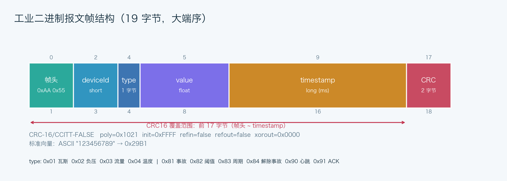

# 通信协议说明

## 1. 设计目标

- **固定长度**：19 字节定长帧，便于工业场景快速定界和解析。
- **大端序**：与常见工业协议一致，Java `ByteBuffer.order(ByteOrder.BIG_ENDIAN)` 编解码。
- **强校验**：CRC-16/CCITT-FALSE 覆盖帧头到时间戳的全部 17 字节。
- **双向通信**：同一帧结构既承载遥测数据，也承载控制指令与 ACK。
- **可恢复**：CRC 错误时只前移 1 字节重新寻找帧头，避免一次脏数据导致后续帧全部丢失。



## 2. 帧结构

| 偏移 | 字段 | 字节数 | 类型 | 说明 |
| --- | --- | --- | --- | --- |
| 0 | frameHeader | 2 | byte[2] | 固定 `0xAA 0x55` |
| 2 | deviceId | 2 | unsigned short | 1 瓦斯、2 负压、3 流量、4 温度；0 为广播 |
| 4 | type | 1 | unsigned byte | 遥测类型或指令码 |
| 5 | value | 4 | float | 遥测数值或指令参数 |
| 9 | timestamp | 8 | long | 毫秒时间戳；ACK 回显请求时间戳 |
| 17 | crc | 2 | unsigned short | CRC16，覆盖偏移 0~16 |

Java 编码核心（`MinePacket.encode()`）：

```java
ByteBuffer buf = ByteBuffer.wrap(data).order(ByteOrder.BIG_ENDIAN);
buf.put((byte) 0xAA).put((byte) 0x55)
   .putShort((short) deviceId)
   .put((byte) dataType)
   .putFloat(value)
   .putLong(timestamp);
int crc = Crc16Util.calcCrc16(data, 17);
Crc16Util.writeCrc16(data, 17, crc);
```

## 3. 数据类型与默认参数

| type | 传感器 | deviceId | 单位 | 默认阈值 | 告警方向 | 默认基值 |
| --- | --- | --- | --- | --- | --- | --- |
| `0x01` | 瓦斯浓度 | 1 | % | ≥ 1.00 | 高值告警 | 0.35 |
| `0x02` | 抽采负压 | 2 | kPa | ≥ -20.0 | 负压不足（数值偏高） | -28.0 |
| `0x03` | 抽采流量 | 3 | m³/min | ≤ 20.0 | 低值告警 | 26.0 |
| `0x04` | 环境温度 | 4 | °C | ≥ 30.0 | 高值告警 | 24.0 |

> 负压用负值表示。例如 -28 kPa 属于正常抽采负压，-18 kPa 表示负压不足；比较规则是“数值高于 -20.0 则告警”。

## 4. CRC16 校验

采用 **CRC-16/CCITT-FALSE**：

```text
poly   = 0x1021
init   = 0xFFFF
refin  = false
refout = false
xorout = 0x0000
```

标准测试向量：

```text
ASCII "123456789" → 0x29B1
```

`Crc16Util` 使用 256 项查表法，一次字节查表而不是逐位循环：

```java
int index = ((crc >>> 8) ^ (data[i] & 0xFF)) & 0xFF;
crc = ((crc << 8) ^ TABLE[index]) & 0xFFFF;
```

发送端编码时把 CRC 写入偏移 17、18（高字节在前）。接收端重新计算偏移 0~16 的 CRC 并比较；不一致抛出 `CrcMismatchException`，该帧丢弃。

## 5. 遥测帧示例

瓦斯传感器 `deviceId=1`，浓度 `0.35%`，时间戳 `1730000000000`：

```text
AA55 0001 01 3EB33333 00000192CC091400 1C9E
```

| 片段 | 含义 |
| --- | --- |
| `AA55` | 帧头 |
| `0001` | 设备 1 |
| `01` | 瓦斯 |
| `3EB33333` | float 0.35 的大端 IEEE-754 表示 |
| `00000192CC091400` | long 1730000000000 |
| `1C9E` | CRC16 |

## 6. 控制指令

指令复用 19 字节结构：

- `deviceId`：目标设备，0 表示广播。
- `type`：指令码。
- `value`：指令参数。
- `timestamp`：客户端发送时间（同时作为请求标识）。
- 网关 ACK：`deviceId` 回显目标设备，`type=0x91`，`value=1` 成功 / `0` 失败，`timestamp` 回显请求时间。

| type | 指令 | 参数 | 示例 |
| --- | --- | --- | --- |
| `0x81` | 触发事故 | 目标设备 + 峰值浓度 | `deviceId=1, value=2.8` |
| `0x82` | 修改阈值 | 目标设备 + 新阈值 | `deviceId=1, value=1.2` |
| `0x83` | 修改采样周期 | 全局 200~5000 ms，deviceId=0 | `value=300` |
| `0x84` | 解除事故 | 目标设备或广播 0 | `deviceId=0` |
| `0x90` | 心跳 | 无 | 每 3 秒 |
| `0x91` | ACK | 1/0 | 回显请求时间戳 |

触发事故示例：

```text
AA55 0001 81 40333333 000001A14F2002B0 0633
```

对应 `deviceId=1, type=0x81（触发事故）, value=2.80`。

### ACK 的 UI 处理

- 服务端只对心跳、指令产生 ACK；随机丢包不作用于 ACK。
- 客户端收到 `deviceId != 0` 的 ACK 时在参数面板显示“网关应答 · 指令执行成功/失败”。
- 心跳 ACK 和周期/解除事故的广播 ACK 不写入告警日志，避免每 3 秒刷屏。

## 7. TCP 拆包算法

TCP 只保证字节流有序，不保留消息边界。`PacketStreamDecoder` 的算法：

```text
循环：
  1. 在缓冲区查找 AA55
     - 找不到：保留末尾可能的半个帧头（AA），其余作为脏字节丢弃
  2. 找到后，若剩余不足 19 字节 → 半包，退出等待下一次 read
  3. 凑满 19 字节 → MinePacket.decode()
     - 成功：加入结果列表，指针 +19
     - CRC 错误：crcErrors++，指针 +1，重新寻找帧头（resync）
     - 其他格式错误：invalidFrames++，指针 +1
  4. 压缩缓冲区，把未消费的半包移到起点
```

关键特性：

- 支持一帧被拆成任意多段到达（半包）。
- 支持一次 `read` 收到多帧（粘包）。
- 支持前导垃圾字节、错误 CRC、帧内出现 `AA55` 等异常。
- 统计 `validPackets / crcErrors / invalidFrames / garbageBytes / resyncs`，在客户端统计栏可见 CRC 错误数。

## 8. 心跳、超时与重连

- 客户端 `mine-net-maintenance` 每 3 秒发送 `0x90` 心跳；网关立即回 `0x91` ACK。
- 客户端记录最后一次收到合法报文的时间；若超过 **12 秒**没有有效数据，主动关闭 Socket 并进入重连。
- 网关关闭、网络中断、Socket 异常都会使读循环退出，监视线程按 1→2→3→4→5 秒退避重连（上限 5 秒）。
- 设备层另有 8 秒离线判定：定时线程每 2 秒巡检 `DeviceManager`，超时设备标记离线并产生预警。

## 9. 客户端接入地址范围

客户端在建立连接前会校验目标地址：

- 允许：`172.20.205.0 ~ 172.20.224.255`（含两端，按无符号 32 位整数比较）。
- 本机调试例外：`127.0.0.1` 与 `localhost`。
- 拒绝：其他 IPv4、非法八位组（如 `172.20.205.256`）、普通域名、`0.0.0.0`。
- 本机工控机源 IP：可选，留空自动使用系统源地址；非空时必须位于上述网段或为 `127.0.0.1`。客户端使用 `Socket.bind()` 绑定该源地址，连接成功后再校验实际源 IP。

该策略实现在 `com.mine.common.IpRange`，只影响客户端连接目标与源地址；网关仍可绑定 `127.0.0.1`、`0.0.0.0` 或本机实际 IP。

## 10. 兼容性与边界

- `deviceId` 范围 0~65535；`type` 0~255；value 不允许 NaN/Infinity。
- 未知 `type` 的帧会被解析但业务层忽略，不崩溃。
- 固定 19 字节意味着当前协议不支持变长负载；若未来要传波形/批量数据，应新增长度字段与版本号，并同步升级拆包器。
- 目前未加密、未做身份认证，属于课程仿真协议；生产环境应增加 TLS、设备证书与重放保护。
