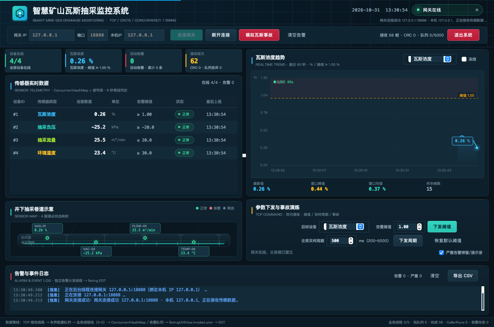
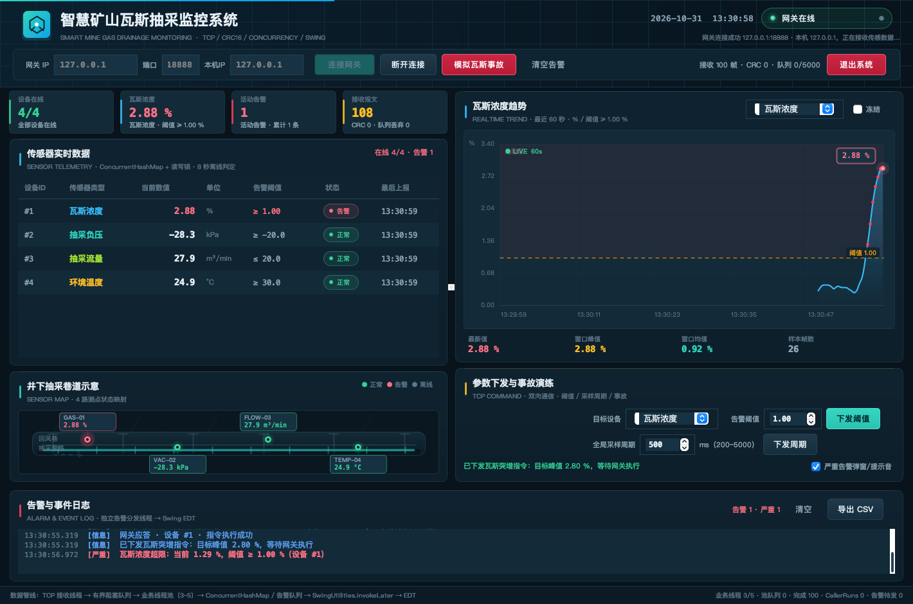
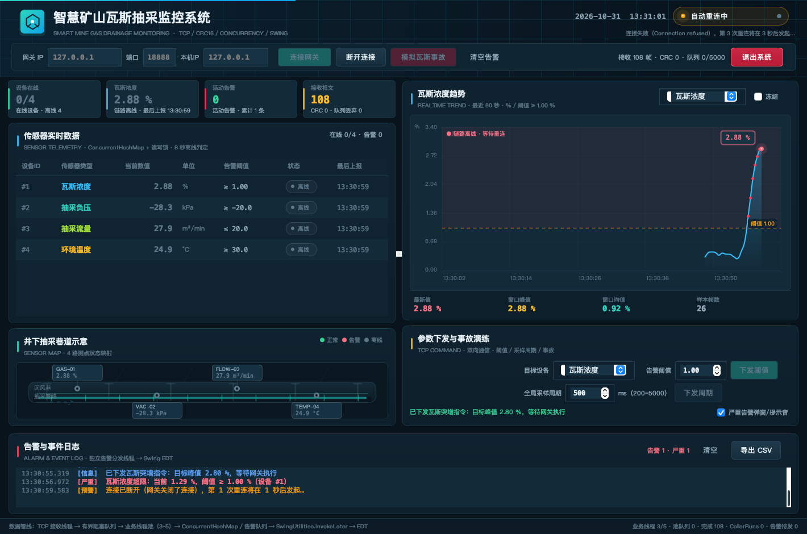

# 测试报告

## 1. 测试环境

| 项 | 配置 |
| --- | --- |
| 操作系统 | macOS（Darwin 25.6.0，Apple Silicon arm64） |
| JDK | OpenJDK 17.0.20.1（源码按 Java 8 语法编写，`--release 8` 构建） |
| 屏幕 | 1512 × 982，截图内容区 1420 × 940 |
| 第三方依赖 | 无（纯 JDK：Socket、并发包、Swing/Java2D） |
| 网关 | 127.0.0.1:8888（自动化测试使用随机端口） |
| 构建 | `./build.sh` 编译 + 生成两个可执行 JAR |
| 测试入口 | `./run-tests.sh`（三个自检程序，非 JUnit） |

## 2. 自动化测试结果

```text
[PASS] ProtocolSelfTest 全部 54 项检查通过
[PASS] ServiceSelfTest 全部 15 项检查通过
[PASS] GatewayClientIntegrationTest 全部 23 项检查通过
全部自检通过（共 92 项）。
```

### 2.1 ProtocolSelfTest（54 项）

| 编号 | 用例 | 预期 | 结果 |
| --- | --- | --- | --- |
| P-01 | CRC 标准向量 `"123456789"` | `0x29B1` | 通过 |
| P-02 | CRC 大端写入/读取 | 0xABCD 往返正确 | 通过 |
| P-03 | 报文编码 | 19 字节、帧头 AA55 | 通过 |
| P-04 | 编码后再解码 | 字段完全一致 | 通过 |
| P-05 | 篡改 value 后解码 | 抛 `CrcMismatchException` | 通过 |
| P-06 | 2 字节短包 | 抛 `PacketFormatException` | 通过 |
| P-07 | 粘包 + 半包（每次 5 字节喂入，带前导脏字节） | 正确拆出 2 帧 | 通过 |
| P-08 | CRC 错误帧后接合法帧 | 能重新同步并解析合法帧 | 通过 |
| P-09 | CRC 错误计数 | ≥1 | 通过 |
| P-10~P-13 | 心跳/ACK/指令构造、ACK 回显时间戳、阈值方向 | 全部正确 | 通过 |
| P-14 | 瓦斯超限/流量偏低/负压正常判断 | 符合阈值方向 | 通过 |
| P-15 | 设备快照告警 | 1.55% ≥ 1.00% 时告警 | 通过 |
| P-16 | 时间戳落后数据 | 被拒绝，不覆盖新值 | 通过 |
| P-17 | 修改阈值 | 提高阈值后解除告警 | 通过 |
| P-18 | 4 写线程 + 4 读线程并发设备访问 | 无异常、始终 4 个设备 | 通过 |
| P-19 | 有界队列容量 3 连续入队 6 帧 | 容量不超限、丢弃计数增加、峰值 ≤3 | 通过 |
| P-20 | 业务池 3~5 线程 + 256 队列 | 饱和后 CallerRunsPolicy 计数 >0，线程数 ≤5 | 通过 |
| P-21 | 8 线程 × 2000 次并发编解码 | 16000 次全部一致 | 通过 |
| P-22 | IP 区间校验 | 172.20.205.0 与 172.20.224.255 允许；越界/非法 IP 拒绝；127.0.0.1/localhost 例外 | 通过 |
| P-23 | 本机源 IP 校验 | 留空自动、网段内地址允许、网段外拒绝、127.0.0.1 调试例外 | 通过 |

### 2.2 ServiceSelfTest（15 项）

| 编号 | 用例 | 预期 | 结果 |
| --- | --- | --- | --- |
| S-01 | 瓦斯 1.8% 入队 | 产生 CRITICAL 告警 | 通过 |
| S-02 | 设备快照 | `isAlarm()==true` | 通过 |
| S-03 | 告警计数 | 严重告警 =1 | 通过 |
| S-04 | 告警队列级别 | CRITICAL | 通过 |
| S-05 | GUI 回调次数 | ≥2 次 | 通过 |
| S-06 | 回调线程 | `biz-worker-*`，不是 EDT | 通过 |
| S-07 | 瓦斯恢复 0.2% | 产生 RECOVERY | 通过 |
| S-08 | 恢复后快照 | 不再告警 | 通过 |
| S-09 | ACK 回调 | success=true | 通过 |
| S-10 | CSV 条数 | 与告警列表一致 | 通过 |
| S-11 | CSV BOM/表头 | UTF-8 BOM + 中文表头 | 通过 |
| S-12 | CSV 内容 | 包含严重告警与恢复 | 通过 |
| S-13 | CSV 告警消息 | 包含“瓦斯浓度超限” | 通过 |
| S-14 | 全部设备离线 | 快照均 `online=false` | 通过 |
| S-15 | 快照数量 | ≥4 | 通过 |

> CSV 使用 `Files.createTempFile` 创建临时文件，测试后删除。

### 2.3 GatewayClientIntegrationTest（23 项）

真实起网关、真实 TCP 连接、真实二进制帧，不使用 Mock。

| 编号 | 用例 | 预期 | 结果 |
| --- | --- | --- | --- |
| I-01 | 网关绑定随机端口 | `getPort() > 0` | 通过 |
| I-02 | 客户端连接 | 8 秒内 CONNECTED | 通过 |
| I-03 | 4 类遥测 | 收齐 type 1~4 | 通过 |
| I-04 | 接收帧 CRC | 重新编码/解码后 CRC 正确 | 通过 |
| I-05 | 心跳 | 3 秒内收到 ACK(deviceId=0) | 通过 |
| I-06 | 阈值指令 | ACK value=1，target=1 | 通过 |
| I-07 | 事故指令 | ACK value=1 | 通过 |
| I-08 | 事故数据 | 9 秒内出现瓦斯 >1.0% | 通过 |
| I-09 | 第二客户端（原始 Socket）接入 | 网关同时接受 2 个连接 | 通过 |
| I-10 | 注入脏字节 + 错 CRC 心跳 + 合法心跳 | 网关 CRC 错误计数 ≥1，仍回 ACK | 通过 |
| I-11 | 网关关闭 | 客户端检测断开 | 通过 |
| I-12 | 自动重连状态 | RECONNECTING/CONNECTING | 通过 |
| I-13 | 原端口重启网关 | 启动成功 | 通过 |
| I-14 | 网关恢复 | 20 秒内自动 CONNECTED | 通过 |
| I-15 | 重连后数据 | 累计接收帧数继续增长 | 通过 |
| I-16~I-21 | 连接、指令、数据、CRC 等检查计数 | 全部通过 | 通过 |
| I-22 | 本机源 IP 绑定 | `Socket.getLocalAddress()` 为 127.0.0.1 | 通过 |
| I-23 | 重连后源 IP 绑定 | 仍为 127.0.0.1 | 通过 |

测试日志中的关键输出：

```text
[TEST] 网关监听端口 57773
[TEST] 脏报文恢复通过，网关 CRC 错误计数=1
[TEST] 自动重连后累计接收 40 帧
[PASS] GatewayClientIntegrationTest 全部 23 项检查通过
```

## 3. 手工 / 可视化测试

### 3.1 正常监控

步骤：启动网关 → 启动客户端 → 网关 IP 填 127.0.0.1、端口 8888、【本机IP】填 127.0.0.1 → 连接。

预期/实际：

- 状态胶囊绿色“网关在线”；
- 4 行传感器数据每约 500ms 更新，最后上报时间递增；
- 瓦斯曲线在最近 60 秒窗口滚动；
- 底部“接收帧数”持续增长，CRC 错误 0；
- 巷道图 4 个节点绿色；
- 顶部【本机IP】显示 127.0.0.1，连接状态显示“本机 127.0.0.1”。



### 3.1.2 每台工控机源 IP 绑定

| 操作 | 预期 | 实际 |
| --- | --- | --- |
| 本机IP 填 127.0.0.1，连接本机网关 | `Socket.bind` 成功，状态显示“本机 127.0.0.1” | 通过 |
| 本机IP 填 172.20.210.37（本机未配置该地址） | 绑定失败，状态提示“Cannot assign requested address”，不无限重连 | 通过 |
| 本机IP 留空 | 自动使用系统源地址，实际源 IP 显示在状态中 | 通过 |
| 本机IP 填 192.168.1.10 | 输入校验拒绝并提示允许范围 | 通过 |
| 两台不同工控机分别填写 172.20.205.11/12 | 网关 `clients` 显示两个不同远端 IP | 待多机环境部署验证（单机绑定逻辑已验证） |

### 3.1.3 网络预检工具

启动网关后执行：

```bash
./check-network.sh --host 127.0.0.1 --port 8888 --local-ip 127.0.0.1
```

| 场景 | 预期 | 实际 |
| --- | --- | --- |
| 本机回环 + 运行中的网关 | `[PASS] 网络预检通过`，收到心跳 ACK | 通过 |
| 指定未配置的 `172.20.205.11` | 退出码 3，提示本机 IP 未配置并列出本机 IPv4 | 通过 |
| 网关未启动 | 退出码 4，提示 TCP 连接失败 | 通过 |
| 目标 IP 不在允许范围 | 退出码 2，提示目标 IP 不合法 | 通过 |

> 测试时本机只有 `10.6.173.116` 和 `127.0.0.1`，没有 `172.20.x` 网卡地址，所以真实 `172.20` 链路需要在配置了静态 IP 的工控机上执行预检；工具会明确报告缺失的地址，不会误报成功。

### 3.2 瓦斯事故告警

步骤：点击【模拟瓦斯事故】。

预期/实际：

- 网关控制台打印事故触发；
- 约 1 秒后瓦斯越过 1.00%；
- 表格瓦斯行变红、状态“告警”；
- 曲线穿越阈值虚线，最新点红色；
- 告警日志出现红色“严重”记录；浮窗与提示音出现（可在参数面板关闭）；
- 点击【解除事故】或等待 18.5 秒后自动回落，日志出现绿色“恢复”。



### 3.3 断线自动重连

步骤：网关控制台执行 `disconnect`，或直接关闭网关进程。

预期/实际：

- 客户端状态变为橙色“自动重连中”，顶部显示重连次数/倒计时；
- 4 个设备状态变灰“离线”，指标卡在线 0/4；
- 曲线右上角显示“链路离线 · 等待重连”；
- 设备离线巡检不重复刷告警；
- 重启网关后，客户端状态自动恢复绿色，数据继续刷新。



### 3.4 参数下发

| 操作 | 预期 | 实际 |
| --- | --- | --- |
| 目标设备=瓦斯，阈值改为 1.20，下发 | 表格阈值即时变为 ≥1.20；网关 ACK；面板显示“指令执行成功” | 通过 |
| 全局采样周期改为 200ms，下发 | 数据刷新明显加快（4×5=20 帧/秒） | 通过 |
| 恢复默认阈值 | 4 条指令下发，阈值恢复 1.00/-20.0/20.0/30.0 | 通过 |
| 解除事故 | 瓦斯开始回落，最终恢复绿色 | 通过 |
| 断开状态下点击下发 | 面板提示未连接，不发送 | 通过 |

### 3.5 脏报文 / 丢包 / 高频压力

- **脏报文**：集成测试向网关注入 3 字节垃圾 + 错 CRC 心跳 + 合法心跳，网关记录 1 次 CRC 失败，并对合法心跳回 ACK；客户端界面不崩溃。
- **5% 丢包**：控制台 `drop 5` 后，客户端接收帧数增长率下降，曲线偶有缺口；队列与线程池稳定，CRC 错误保持 0（丢包不是坏帧）。
- **高频**：控制台 `period 200`，约 20 帧/秒；阻塞队列占用仍接近 0，GUI 无卡顿、无闪烁。底部线程池统计显示 3/5 线程、CallerRuns 0。
- **慢消费**：人为在调试环境暂停消费者时，队列容量达到上限后丢弃最旧帧，`队列丢弃` 计数增加，网络线程不被阻塞。

### 3.6 CSV 导出

步骤：产生若干告警后点击【导出 CSV】，选择路径。

预期/实际：

- 文件带 UTF-8 BOM，Excel 打开中文不乱码；
- 表头：序号、时间、级别、设备 ID、传感器类型、数值、单位、阈值、告警信息；
- 严重告警、恢复记录完整；消息内的逗号被正确转义；
- 导出在 `csv-export` 后台线程执行，界面不卡顿。

### 3.7 退出系统

步骤：点击右上角【退出系统】→ 确认“是(Y)”；或按 `Ctrl+Q` / `⌘Q`。

预期/实际：

- 弹出确认框；
- 确认后窗口关闭，进程退出；
- 网络线程、业务线程池、告警分发线程和时钟定时器全部停止；
- 再次启动客户端时端口可正常绑定。

实测：自动化脚本找到【退出系统】并点击，确认框弹出，点击“是(Y)”后 JVM 以退出码 0 正常结束。

## 4. 边界与异常覆盖

| 场景 | 处理 |
| --- | --- |
| 客户端 IP 为空 / 端口非数字 / 越界 | 输入校验 + 对话框提示，不发起连接 |
| 网关未启动 | 自动重连，状态栏显示失败原因 |
| 连续点击连接 | `running` 原子状态阻断重复连接 |
| 连接过程中点击断开 | `generation` 代际使旧监视线程失效 |
| 网关只发垃圾/坏 CRC | 拆包器重同步，不抛到 UI |
| 设备超过 8 秒无数据 | 标记离线，产生预警，快照保留最后值 |
| 告警持续 | 边沿去重，只记一次，避免刷屏 |
| 队列满 | 丢旧/反压/丢新，均有计数，不 OOM |
| 关闭窗口 | 停定时器、关客户端、停业务池/告警线程，退出 |
| 端口占用 | 网关启动失败并提示检查端口 |

## 5. 性能观察（单机仿真）

| 指标 | 数值 |
| --- | --- |
| 默认采样 | 4 路 × 2 Hz = 8 帧/秒 |
| 高频模式 | 4 路 × 5 Hz = 20 帧/秒 |
| 单帧 | 19 字节（约 152 bit） |
| 曲线保留 | 每类最多 900 点，仅绘制最近 60 秒 |
| 数据队列 | 5000，实际占用接近 0 |
| 业务线程池 | 3 个核心线程，最大 5 个 |
| GUI 刷新 | 每帧一次 `invokeLater`，20 帧/秒下稳定 |

## 6. 已知限制

1. 协议固定 19 字节，不支持变长负载、版本协商、加密与身份认证。
2. 断线重连只针对单网关地址，未实现多网关故障转移。
3. 设备离线判定为固定 8 秒，未按传感器类型配置不同超时。
4. 曲线数据仅保存在内存，重启后丢失；CSV 仅导出告警，不导出完整时序。
5. 未做真实硬件 Modbus/OPC-UA 接入，传感器为软件仿真。
6. 单机 20 帧/秒下的性能结论不能直接外推到数百测点；生产环境建议 Netty + 时序库。

## 7. 复现方式

```bash
./build.sh
./run-tests.sh
java -cp out/classes com.mine.client.tools.GuiScreenshotTool docs/screenshots
```

截图工具会在 18888 端口启动临时网关，真实连接后依次生成正常、告警、断线三张截图。
