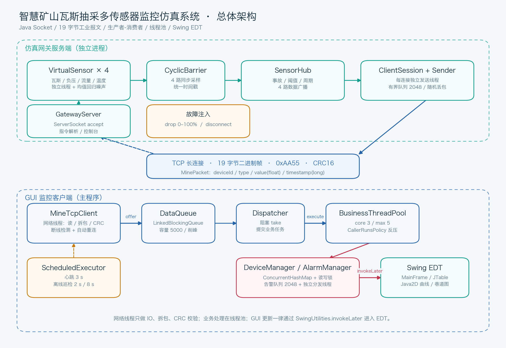
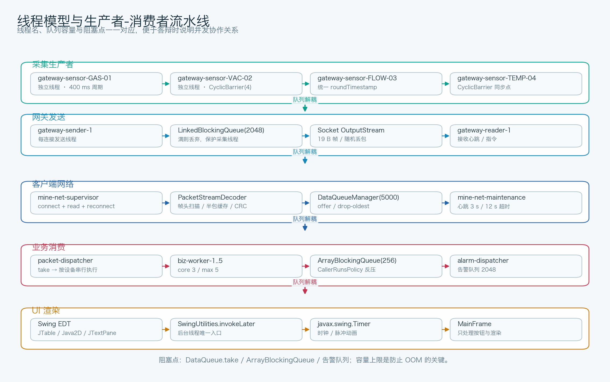
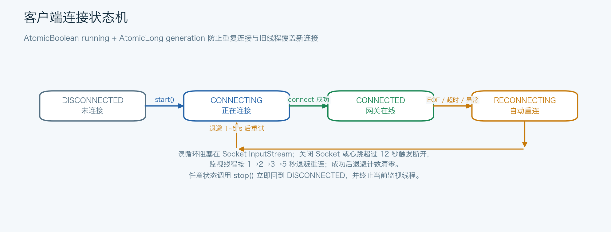
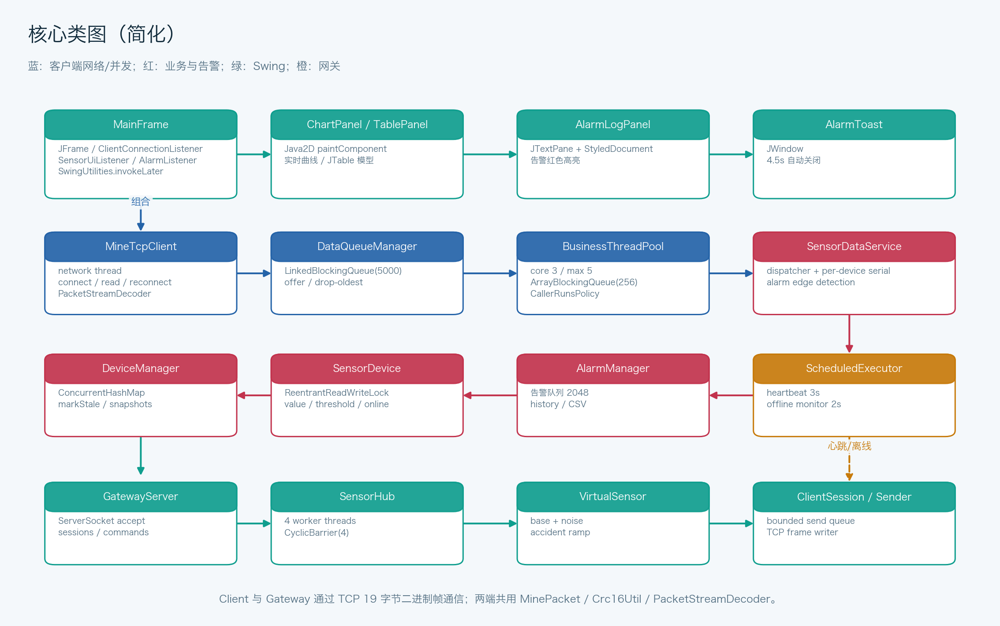

# 系统设计与并发说明

## 1. 目标与总体思路

系统由两个可独立运行的程序组成：

- **仿真网关服务端**：模拟井下边缘网关，多线程生成 4 路传感器数据，通过 TCP 推送上位机，并接收控制指令。
- **Swing 监控客户端**：TCP 长连接接入网关，生产者-消费者并发处理报文，维护设备状态与告警，实时可视化。

设计重点不是“把数据画出来”，而是把 **网络 IO、并发处理、界面渲染** 三层彻底解耦：

```text
Socket 字节流
   │  网络线程：只做 read / 拆包 / CRC / offer
   ▼
有界阻塞队列（削峰）
   │  分发线程：take / 按设备串行
   ▼
业务线程池（3~5 线程）
   │  ConcurrentHashMap + 读写锁 / 告警边沿判断
   ▼
告警队列 + SensorUiListener
   │  SwingUtilities.invokeLater
   ▼
EDT：JTable / Java2D / JTextPane
```



## 2. 模块划分

### 2.1 公共层 `com.mine.common`

| 类 | 职责 |
| --- | --- |
| `Protocol` | 帧头、长度、设备号、类型、指令码、ACK 工厂 |
| `MinePacket` | 不可变报文实体；大端编码/解码、CRC 校验、格式化 |
| `Crc16Util` | CRC-16/CCITT-FALSE 查表实现 |
| `PacketStreamDecoder` | 半包缓存、帧头扫描、CRC 错误重同步、统计 |
| `SensorType` | 4 类传感器的单位、阈值、告警方向、显示精度 |

公共层不依赖 Swing，网关与客户端共用，避免两端协议实现漂移。

### 2.2 仿真网关 `com.mine.gateway`

| 类 | 职责 |
| --- | --- |
| `GatewayMain` | 参数解析、启动/关闭、控制台入口 |
| `GatewayServer` | `ServerSocket` accept 循环；会话管理；广播；指令处理；故障注入 |
| `GatewayConsole` | 演示命令：事故、阈值、周期、丢包、断线、状态 |
| `SensorHub` | 4 路传感器线程、`CyclicBarrier(4)`、事故/阈值/周期 |
| `VirtualSensor` | 均值回归 + 噪声；事故爬升/保持/回落曲线 |
| `ClientSession` | 每连接接收线程、发送队列、CRC 统计 |
| `GatewayPacketSender` | 每连接发送线程，队列 → Socket |

### 2.3 客户端 `com.mine.client`

| 包/类 | 职责 |
| --- | --- |
| `network.MineTcpClient` | 连接监督、读循环、心跳、超时、自动重连、发送指令、绑定本机源 IP |
| `common.IpRange` | 客户端连接地址策略：`172.20.205.0 ~ 172.20.224.255`，例外 `127.0.0.1/localhost` |
| `network.PacketStreamDecoder`（common） | 拆包与 CRC |
| `concurrent.DataQueueManager` | 有界数据队列（5000），满则丢最旧 |
| `concurrent.BusinessThreadPool` | core 3 / max 5 / ArrayBlockingQueue(256) / CallerRunsPolicy |
| `service.SensorDataService` | 分发、按设备串行、告警边沿、离线巡检 |
| `service.DeviceManager` | `ConcurrentHashMap<Integer, SensorDevice>` |
| `service.SensorDevice` | 每设备 `ReentrantReadWriteLock`，时间戳单调校验 |
| `service.AlarmManager` | 告警队列 2048、独立分发线程、历史与计数 |
| `service.CsvExporter` | UTF-8 BOM CSV 导出 |
| `gui.MainFrame` | 主窗口、事件、回调、EDT 调度 |
| `gui.*Panel` | 表格、曲线、巷道图、告警日志、参数下发 |
| `tools.GuiScreenshotTool` | 自动联调并生成报告截图 |

## 3. 线程模型



### 3.1 网关线程

- **4 个传感器线程**：`gateway-sensor-GAS-01` 等。每轮先 `Thread.sleep(period)`，再 `barrier.await(12s)`。
- **CyclicBarrier(4) action**：最后到达的线程写入本轮统一 `roundTimestamp`，然后 4 个线程同时采样。这样 4 帧数据时间戳一致，模拟“同一时刻采样”。
- **广播**：`SensorHub` 将 4 帧交给 `GatewayServer.broadcast()`，后者遍历会话并入队。
- **每连接发送线程**：`gateway-sender-N` 从 `LinkedBlockingQueue(2048)` 取帧写 Socket；慢客户端只会丢自己的帧，不阻塞采集。
- **每连接接收线程**：`gateway-reader-N` 解析心跳/指令，CRC 失败只记录并丢弃。
- **accept 线程**：`gateway-accept` 只负责建立连接和启动会话。

### 3.2 客户端线程

- **`mine-net-supervisor`**：连接、阻塞读、EOF/异常后按退避重连。拆包和 CRC 全部在该线程完成，绝不做业务。
- **`mine-net-maintenance`**：`ScheduledExecutorService`，每 1 秒检查一次；每 3 秒发心跳；12 秒无有效数据主动关 Socket。
- **`packet-dispatcher`**：`DataQueueManager.poll(250ms)`，把遥测任务交给对应设备的串行执行器，ACK/指令交给业务池。
- **`biz-worker-1..5`**：业务任务；池队列满时 `CallerRunsPolicy` 在分发线程执行，形成反压。
- **`alarm-dispatcher`**：独立消费告警队列，调用 `MainFrame.onAlarm`，后者再 `invokeLater`。
- **`device-offline-monitor`**：每 2 秒检查设备最后上报时间，超过 8 秒标记离线并产生预警。
- **Swing EDT**：按钮事件、`javax.swing.Timer`、所有组件更新与绘制。

## 4. 并发核心设计

### 4.1 有界队列削峰

网络层 `DataQueueManager` 使用 `LinkedBlockingQueue<MinePacket>(5000)`：

```java
if (!queue.offer(packet)) {
    queue.poll();        // 丢弃最旧
    queue.offer(packet); // 保留最新
    dropped.incrementAndGet();
}
```

网络线程永不阻塞在队列上。队列满时选择**丢旧保新**，符合监控系统“当前状态最重要”的语义。网关侧每个会话也有 2048 容量的发送队列，慢客户端不会拖垮采集。

### 4.2 自定义线程池与反压

```java
corePoolSize = 3
maximumPoolSize = 5
keepAlive = 60s
workQueue = new ArrayBlockingQueue<>(256)
rejectedExecutionHandler = CallerRunsPolicy（带计数）
```

当 3 个核心线程 + 2 个临时线程都在忙、队列 256 也满时，任务在提交者线程（`packet-dispatcher`）执行。这样消费速度变慢会自然减慢队列取出，形成端到端反压，而不是无限堆积或直接拒绝。`getCallerRuns()` 在界面底部实时显示，便于演示。

### 4.3 按设备串行、不同设备并行

单纯把每个报文都丢进 3~5 个线程，会让同一测点的报文乱序完成：

```text
网络顺序：瓦斯 0.4 → 瓦斯 1.8 → 瓦斯 0.2
线程池完成顺序可能：1.8 → 0.2 → 0.4
```

虽然 `SensorDevice.update` 会拒绝时间戳落后的数据，但如果“旧的高值”被新值覆盖后才完成，可能产生不必要的告警回退。`SensorDataService` 为每个 deviceId 维护一个 `SerialExecutor`：

- 同一设备的任务进入自己的 `ConcurrentLinkedQueue`，一次只执行一个。
- 不同设备仍由线程池并行处理（4 路测点最多 4 个在途串行器）。
- 任务队列由线程池驱动，仍然受 `CallerRunsPolicy` 反压。
- 与 `SensorDevice` 的时间戳单调校验形成双保险。

### 4.4 ConcurrentHashMap + ReentrantReadWriteLock

```java
ConcurrentHashMap<Integer, SensorDevice> deviceMap;
```

`SensorDevice` 内部：

```java
ReentrantReadWriteLock lock;
double value;
double threshold;
long timestamp;
long lastUpdateMillis;
boolean online;
long sampleCount;
```

- 写：业务线程更新数值、在线状态、样本计数，持有写锁。
- 读：GUI 通过 `snapshot()` 持读锁拷贝出不可变 `DeviceSnapshot`，EDT 后续渲染不再持锁。
- 读多写少，读写锁允许多个 GUI 读取与离线巡检并发进行；`snapshot` 避免把锁对象暴露给 UI。
- 设备表本身由 `ConcurrentHashMap` 保证并发安全，新增未知设备使用 `putIfAbsent`。

### 4.5 原子类与连接代际

`MineTcpClient` 使用：

- `AtomicBoolean running`：用户是否希望保持连接。
- `AtomicBoolean connected`：当前 Socket 是否可用。
- `AtomicLong generation`：每次 start/stop 自增。

监视线程启动时捕获自己的 `gen`，所有状态回调和 Socket 赋值都检查 `generation == gen`。这样快速“断开 → 再连接”时，旧监视线程不会把新连接关掉，也不会把旧状态写回界面。

### 4.6 Swing EDT 单线程规则

所有网络/业务/告警线程都不直接调用 `JLabel.setText`、`JTable` 模型或 `repaint`。统一模式：

```java
SwingUtilities.invokeLater(() -> {
    tablePanel.updateSnapshot(snapshot);
    chartPanel.addSnapshot(snapshot);
    mapPanel.update(snapshot);
    refreshCards();
});
```

告警链路：

```text
业务线程 → AlarmManager.publish() → 告警队列 → alarm-dispatcher
         → MainFrame.onAlarm() → invokeLater → 告警面板/浮窗/计数
```

这样即使业务线程高频回调，Swing 组件也只在 EDT 被单线程访问。

### 4.7 告警边沿检测

`SensorDataService` 维护 `ConcurrentHashMap<Integer, Boolean> alarmStates`：

- 正常 → 超限：产生一条 `CRITICAL`。
- 超限 → 正常：产生一条 `RECOVERY`。
- 持续超限：不重复产生，避免每 500ms 刷一条日志。
- 设备离线：从告警状态表移除；重新上线后若仍超限，会再次产生告警。

这保证告警日志可读，也减少 GUI 压力。

### 4.8 心跳、超时与重连



- 心跳：每 3 秒 `CMD_HEARTBEAT`，网关回 ACK。
- 链路超时：12 秒无有效帧（不是无字节）主动关闭 Socket。
- 重连退避：1→2→3→4→5 秒（上限 5 秒），成功后清零。
- `stop()` 是用户主动断开，必须立即停止重连；`shutdown()` 还会关闭心跳调度器。
- GUI 状态：`DISCONNECTED / CONNECTING / CONNECTED / RECONNECTING`，连接按钮与参数下发按钮随状态切换。

## 5. 服务端设计细节

### 5.1 虚拟传感器

每类传感器有基础值、噪声幅度和随机种子：

```text
瓦斯 0.35 ± 0.025   负压 -28 ± 1.1   流量 26 ± 1.0   温度 24 ± 0.45
```

采样使用均值回归，避免随机游走漂移：

```java
trend = trend * 0.55 + (target - current) * 0.18;
current += trend + random.nextGaussian() * noise;
```

事故曲线：

- 0~2.5s 爬升到峰值（默认 2.8%）。
- 保持 9s。
- 用 7s 回落到基础值。
- 共 18.5s 后自动结束；也可以控制台下 `reset` 立即解除。

### 5.2 多客户端

每个客户端一个 `ClientSession`：

- 接收线程处理心跳/指令；
- 发送线程消费自己的发送队列；
- 广播时逐会话入队，随机丢包按会话独立计算；
- 任一客户端断开只移除自己的会话，不影响其他客户端。

### 5.3 指令处理

`GatewayServer.handlePacket` 根据 `type` 分发：

- `0x90` 心跳 → 立即 ACK（不参与随机丢包）。
- `0x81` → `SensorHub.triggerAccident`。
- `0x82` → 目标传感器阈值更新。
- `0x83` → 全局采样周期（200~5000ms）。
- `0x84` → 解除事故。
- 未知指令 → ACK 失败。
- 客户端上传遥测类型 → 记录警告并忽略。

## 6. GUI 设计

### 6.1 布局

- **NORTH**：品牌标题、状态胶囊、时钟、IP/端口/本机IP、连接/断开/事故/清空、实时统计、退出系统。
- **CENTER**：左侧指标卡 + 传感器表 + 巷道图；右侧曲线 + 参数下发。
- **SOUTH**：告警日志卡 + 底部管线状态条。

### 6.2 表格

- `AbstractTableModel` 维护 `List<DeviceSnapshot>` 与 id→row 索引。
- 自定义单元格渲染：类型颜色、数值右对齐、等宽字体、状态徽章。
- 行交替背景、极简表头、行 tooltip、最后上报时间。
- 深色滚动条 `BasicScrollBarUI` 定制。

### 6.3 曲线

`ChartPanel` 纯 Java2D：

- 每类传感器维护最多 900 个采样（`ArrayDeque`），显示最近 60 秒。
- Y 轴动态范围：包含阈值与数据，带 padding；瓦斯从 0 开始。
- 阈值虚线、危险区半透明红色、告警点红色、最新值气泡。
- 折线使用二次曲线中点平滑；曲线下方渐变填充。
- 支持切换传感器与“冻结”；离线时显示“链路离线 · 等待重连”。
- 每秒定时重绘，让时间轴继续滚动。

### 6.4 巷道图

`MineMapPanel` 将 4 个 deviceId 映射到巷道测点：

- 背景岩石纹理、支护、抽采管路、风流箭头。
- 正常绿色、告警红色脉冲、离线灰色。
- 每个测点显示 tag 与数值；告警时节点带呼吸光环。
- `javax.swing.Timer` 110ms 驱动脉冲动画。

### 6.5 告警日志与导出

- `JTextPane + StyledDocument`：时间、级别标签、消息分色。
- 严重红、预警橙、恢复绿、信息蓝；只读、自动滚动、最多保留约 18 万字符。
- 导出：`JFileChooser` 选路径后，后台线程调用 `CsvExporter`，完成后 `invokeLater` 弹窗；CSV 写 UTF-8 BOM，Excel 中文不乱码。

### 6.6 虚拟机无窗口关闭按钮

主界面控制条右侧提供【退出系统】按钮。点击后弹出确认框，确认后 `shutdownApplication()` 依次停止 UI 定时器、关闭客户端、停止业务服务/告警线程/线程池，再释放窗口；虚拟机没有标题栏或关闭按钮时也能完整退出。另绑定 `Ctrl+Q` / `⌘Q` 快捷键，按钮不在可视区域时也可退出。

## 7. 难点与解决方案

### 7.1 Swing 线程违规

**问题**：网络线程直接改 `JTable`/`JLabel` 会导致随机崩溃、界面闪烁、偶发死锁。  
**方案**：所有回调统一 `SwingUtilities.invokeLater`；网络/业务层通过接口 `SensorUiListener`/`AlarmListener` 与 GUI 解耦。EDT 中不做网络 IO、文件导出、锁等待。

### 7.2 TCP 粘包/半包

**问题**：一次 read 可能拿到 1.5 帧、3 帧或半帧。  
**方案**：固定 19 字节 + 帧头扫描 + 半包缓存 + CRC 失败逐字节重同步。单独类 `PacketStreamDecoder` 可复用、可测试。

### 7.3 并发容器与锁选择

**问题**：`HashMap` 并发修改异常；全局锁会让 GUI 读取阻塞。  
**方案**：设备表 `ConcurrentHashMap`；单设备 `ReentrantReadWriteLock`；GUI 读取快照而不是遍历内部字段。

### 7.4 重复连接与旧线程覆盖

**问题**：快速点击连接/断开，可能创建多个 Socket 或旧线程关闭新连接。  
**方案**：`running` 原子状态 + `generation` 代际编号；旧监视线程所有操作校验代际；Socket 关闭前比较当前 Socket 引用。

### 7.5 高频刷新导致界面卡顿

**问题**：每帧整表刷新 + 曲线全量重绘。  
**方案**：只更新对应行；曲线限制 900 点、只画 60 秒窗口；告警边沿去重；离屏组件不重绘（巷道图 `isShowing` 判断）；真正耗时任务（CSV）放后台。

### 7.6 队列无限增长 / OOM

**问题**：网络生产速度大于业务消费速度。  
**方案**：数据队列 5000、业务池队列 256、网关发送队列 2048、告警队列 2048；满时分别丢旧/反压/丢新，均有计数。

## 8. 类图



## 9. 可扩展方向

- 将 19 字节定长协议升级为带版本号、长度、序列号的变长协议。
- 用 Netty 替换手写 NIO/线程模型，支持更高并发与 TLS。
- 设备状态持久化到 SQLite/时序数据库，曲线支持历史回放。
- 告警规则配置化（多级阈值、持续时间、迟滞）。
- 多网关管理、设备拓扑与真实 OPC-UA/Modbus 接入。
